# MetroPulse

A trip planner for the Bangalore metro. It finds your route across the network, tells you where to change and what the trip costs, and shows how busy each station is likely to be.

[](https://github.com/Shriram60/Metro-Pulse/actions/workflows/ci.yml)
[](LICENSE)


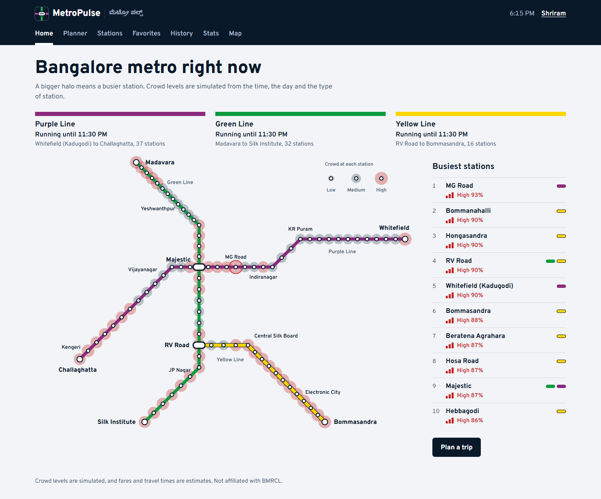

## Features

- **Real routes.** Searches a graph of the 83 stations on the Purple, Green and Yellow lines, so it knows where to change and which direction to board.
- **A strip map for every trip.** Shows each stop in order, the time you reach each change, the fare and the likely crowd.
- **Service hours that account for the whole trip.** Each line is checked at the time you would reach it, so a late trip warns you about the connection you would miss.
- **A live network diagram.** Drawn from the station data, with a halo around each stop that grows with its crowd. Select any stop to plan a trip from it.
- **Station search.** Find a station by name or browse by line.
- **Accounts.** Save favorite routes, keep a log of your trips with totals, and set a home station that the planner starts from.
- **Crowd patterns.** Charts of how the crowd changes through the day and the week.
- **Works on a phone.** Every page adapts down to small screens.

> **Crowd levels are simulated.** No public live ridership feed exists for the network, so they come from a model of the time, the day and the type of station. See [Limits](#limits).

## Screenshots

These come from the running demo, with the browser clock set to a weekday at 6:15 PM to show the evening rush.

### Planner

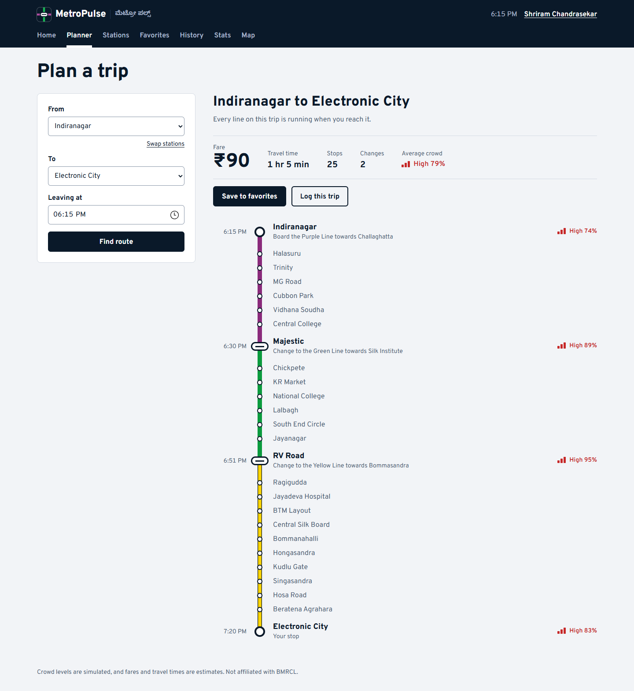

### All pages

<table>
  <tr>
    <td width="50%"><strong>Stations</strong><br>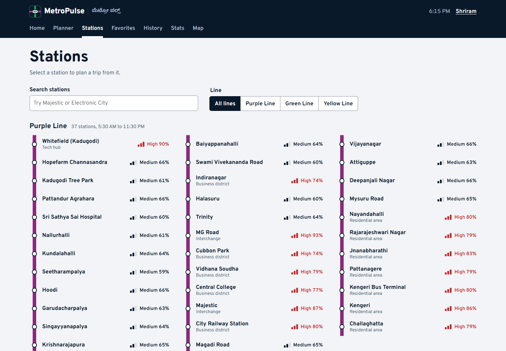</td>
    <td width="50%"><strong>Crowd patterns</strong><br>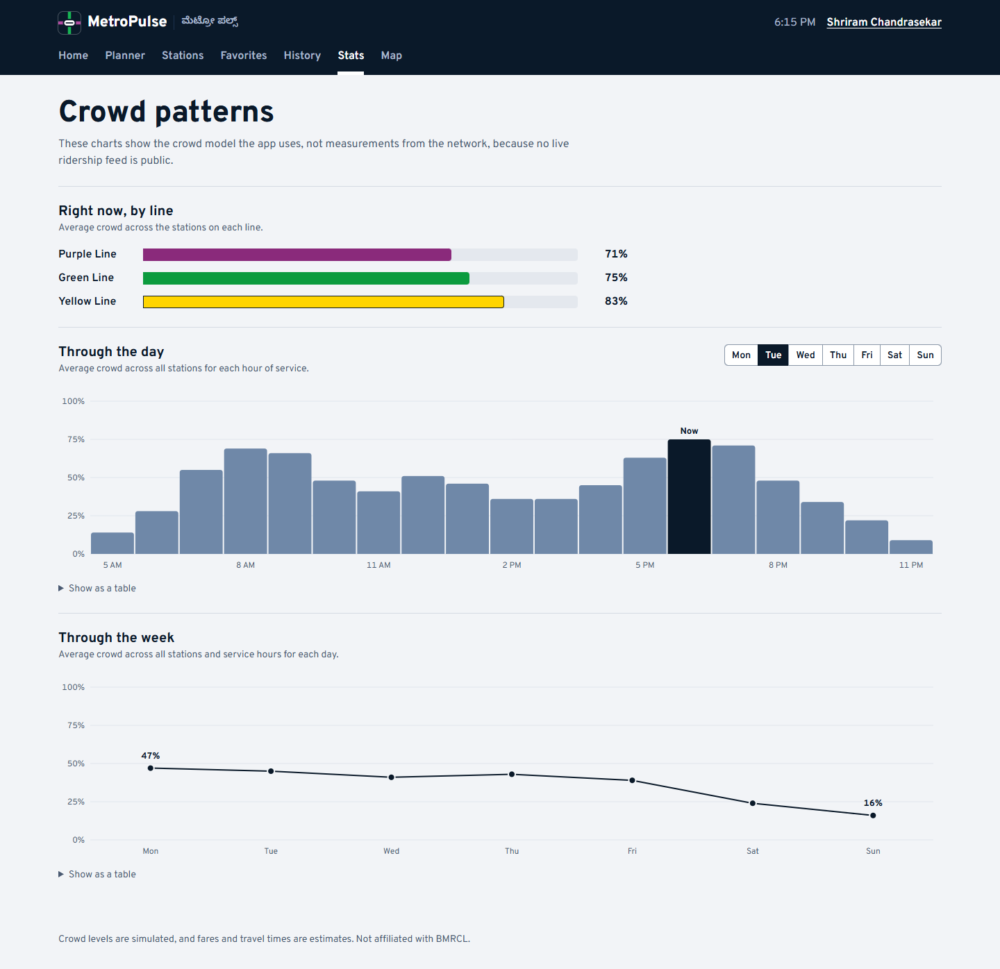</td>
  </tr>
  <tr>
    <td><strong>Favorites</strong><br>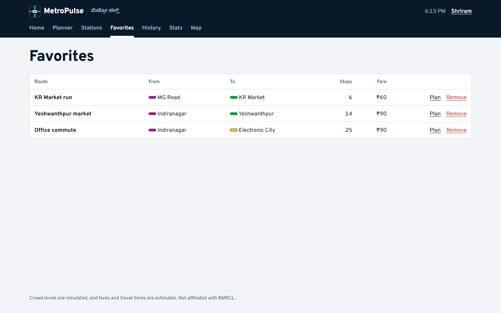</td>
    <td><strong>Trip history</strong><br>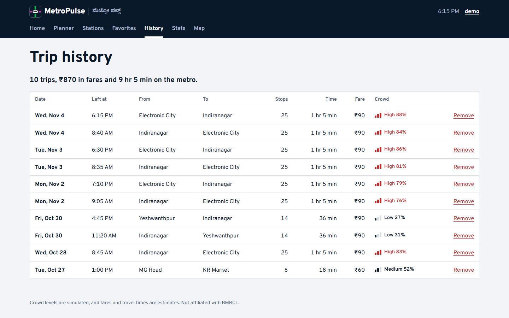</td>
  </tr>
  <tr>
    <td><strong>Outside service hours</strong><br>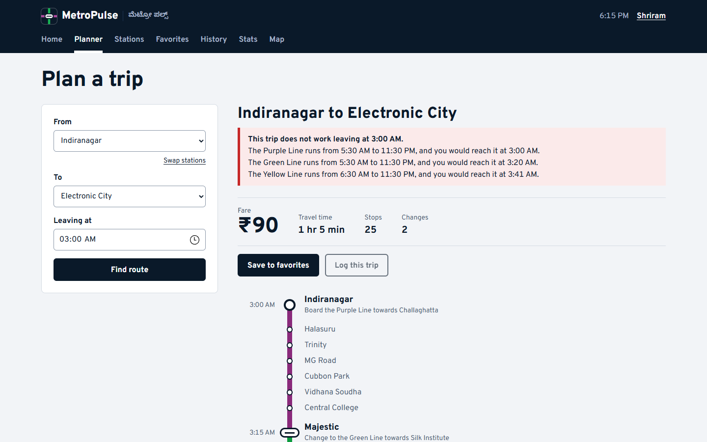</td>
    <td><strong>Network map</strong><br>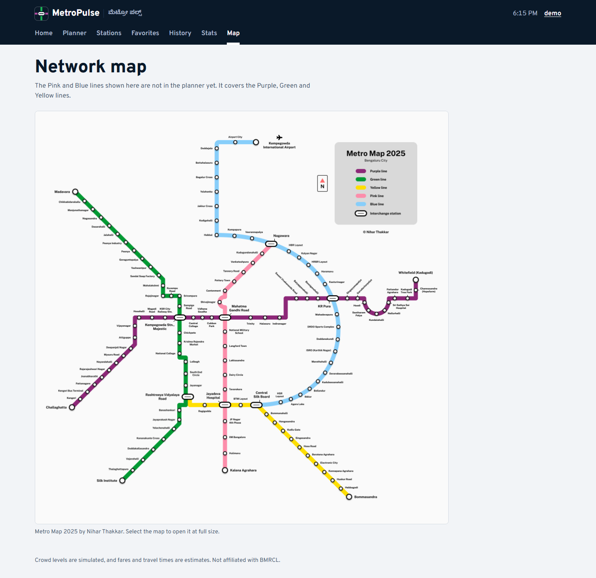</td>
  </tr>
  <tr>
    <td><strong>Log in</strong><br>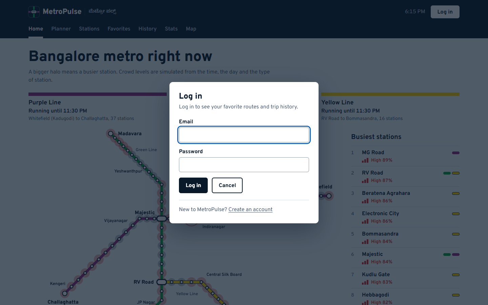</td>
    <td><strong>Profile</strong><br>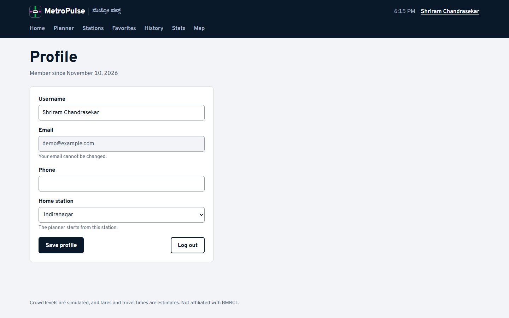</td>
  </tr>
</table>

### On a phone

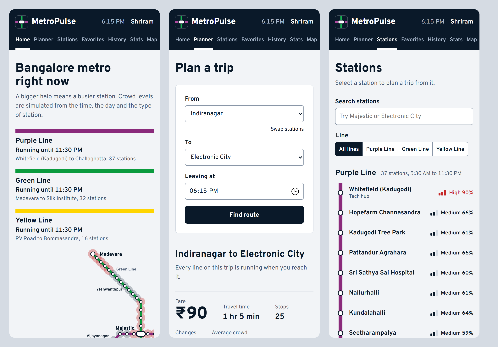

## Run it

You need [Node.js](https://nodejs.org) 20 or newer.

### Quick demo

This needs no database. It starts a temporary MongoDB in memory with a sample account, and everything is deleted when you stop it.

```bash
git clone https://github.com/Shriram60/Metro-Pulse.git
cd Metro-Pulse
npm run setup
npm run demo
```

Open the address printed by Vite, usually <http://localhost:3000>, and log in with:

| Email | Password |
|---|---|
| `demo@example.com` | `metropulse` |

### With your own MongoDB

Copy the example settings and fill them in:

```bash
cp backend/.env.example backend/.env
npm run dev
```

The stations are added to an empty database the first time the server starts.

| Setting | File | Purpose |
|---|---|---|
| `MONGODB_URI` | `backend/.env` | Your MongoDB connection string |
| `JWT_SECRET` | `backend/.env` | Signs login tokens. Required when `NODE_ENV` is `production` |
| `PORT` | `backend/.env` | API port, 5000 by default |
| `VITE_API_URL` | `front-end/.env` | Only needed if the API is on another host |

If port 5000 is taken, as it often is on a Mac, run `PORT=5001 npm run demo`. In PowerShell, run `$env:PORT=5001; npm run demo`.

### Tests

```bash
npm test
```

The backend tests run the API against a real in-memory MongoDB and cover the route planner, validation, and users being unable to reach each other's data. The frontend tests cover the crowd model and the main flows in the interface. GitHub Actions runs both, plus a production build, on every push to `main` and every pull request.

## How it works

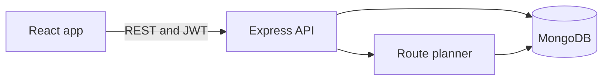

**Route planning.** Stations with the same name are one physical station, which is how Majestic and RV Road join the lines into one graph. A breadth-first search finds the path with the fewest stops, and consecutive hops on one line become a leg with a direction of travel. This all happens on the server, so saved fares and trip lengths cannot be set by the client. The code is in [`routePlanner.js`](backend/src/services/routePlanner.js).

**Crowd model.** Each type of station has a typical peak for the morning, midday and evening. That is scaled by the hour and the day of the week, with a small variation that stays the same for ten minutes, so every page agrees on a number. The code is in [`crowd.js`](front-end/src/lib/crowd.js).

**Network diagram.** Each line is defined by a few anchor points, and the stations are spaced evenly between them. The code is in [`diagram.js`](front-end/src/lib/diagram.js).

## API

Routes marked with a lock need an `Authorization: Bearer <token>` header. Register and log in both return a token.

| Method | Endpoint | Description |
|---|---|---|
| POST | `/api/auth/register` | Create an account |
| POST | `/api/auth/login` | Log in |
| GET | `/api/auth/me` 🔒 | Get your profile |
| PATCH | `/api/auth/me` 🔒 | Update your username, phone or home station |
| GET | `/api/stations` | List all stations |
| GET | `/api/stations/line/:line` | List the stations on a line, in order |
| GET | `/api/lines` | List the lines and their hours |
| GET | `/api/routes/plan?from=PL19&to=GL19` | Plan a route between two station ids |
| GET | `/api/favorites` 🔒 | List your saved routes |
| POST | `/api/favorites` 🔒 | Save a route, with `from`, `to` and an optional `label` |
| DELETE | `/api/favorites/:id` 🔒 | Remove a saved route |
| GET | `/api/journeys` 🔒 | List your trips, newest first |
| POST | `/api/journeys` 🔒 | Log a trip, with `from`, `to`, `departureTime` and `crowdLevel` |
| DELETE | `/api/journeys/:id` 🔒 | Remove a trip |

A planned route looks like this, shortened to the first leg's end points:

```json
{
  "from": { "stationId": "PL19", "name": "MG Road", "line": "purple" },
  "to": { "stationId": "GL19", "name": "KR Market", "line": "green" },
  "stations": 7,
  "stops": 6,
  "interchanges": 1,
  "fare": 60,
  "minutes": 18,
  "legs": [
    {
      "line": "purple",
      "towards": "Challaghatta",
      "stations": [
        { "stationId": "PL19", "name": "MG Road", "type": "interchange", "minute": 0 },
        { "stationId": "PL23", "name": "Majestic", "type": "interchange", "minute": 9 }
      ]
    }
  ]
}
```

## Project structure

```
Metro-Pulse/
├── backend/
│   ├── server.js             Connects to MongoDB and starts the API
│   ├── scripts/demo.js       Runs the API on an in-memory database
│   ├── src/
│   │   ├── data/             The lines and stations
│   │   ├── middleware/       Login checks and error handling
│   │   ├── models/           Mongoose schemas
│   │   ├── routes/           API endpoints
│   │   └── services/         The route planner
│   └── tests/
├── front-end/
│   ├── public/               Icons and the network map
│   └── src/
│       ├── components/       The diagram, route strip, charts and shared pieces
│       ├── lib/              The crowd model, diagram layout and helpers
│       ├── pages/            One file per page
│       └── test/
└── docs/screenshots/
```

## Limits

- **Crowd levels are simulated**, as described above. They are not measurements.
- **Fares are estimates.** They use ₹10 to ₹90 slabs based on the number of stations, not the official fare table.
- **Travel times are estimates**, at 2.2 minutes per stop and 5 minutes per change.
- **Service hours are fixed values** in the station data, not a live timetable.
- **The Pink and Blue lines are not in the planner**, though they appear on the network map.

## Roadmap

- Add the Pink and Blue lines
- Use the official fare table
- Replace the crowd model with live data if a public feed appears
- Add notifications for service delays
- Build a React Native app

## Credits

The network map in [`front-end/public/map.jpeg`](front-end/public/map.jpeg) is © Nihar Thakkar and is not covered by this project's license. MetroPulse is an independent project and is not affiliated with BMRCL.

## License

[MIT](LICENSE), by [Shriram Chandrasekar](https://github.com/Shriram60).
